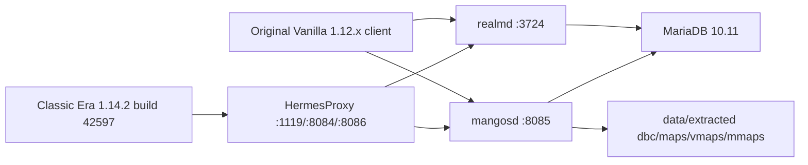

# Architecture

## Containers

| Service | Role |
| --- | --- |
| `db` | MariaDB with a named Docker volume. |
| `db-init` | One-shot Classic-DB import service. |
| `tools` | One-shot extractor/runtime utility service. |
| `realmd` | Legacy authentication server. |
| `mangosd` | Legacy world server with PlayerBots companions/world population and AHBot auctions enabled by default. |

The same base compose services are used by Windows Docker Desktop and Linux Podman. Windows helpers live in `scripts/*.ps1`; Linux helpers live in `scripts/linux/*.sh` and add `docker-compose.linux.yml` for Linux bind mounts.

PlayerBots and AHBot normally build with `BUILD_PLAYERBOTS=ON` and `BUILD_AHBOT=ON` and run with `PLAYERBOTS_ENABLED=1` and `AHBOT_ENABLED=1`. Fresh database initialization imports their database support; first world startup initializes bot accounts and characters and takes longer. Existing databases need a separately verified migration before enabling previously absent bot support; see [PlayerBots](playerbots.md#existing-installations). HermesProxy is a separate optional advanced route, not required for bots or direct Vanilla play.

## Local State

| Path | Contents | Git |
| --- | --- | --- |
| `.env` | Local passwords, ports, rates, bot tuning. | ignored |
| `data/extracted/` | `dbc`, `maps`, `vmaps`, `mmaps`. | ignored |
| `data/hermesproxy-src/` | Pinned HermesProxy checkout. | ignored |
| `data/hermesproxy/` | Published host-native HermesProxy binaries/config for `start-proxy.ps1`. | ignored |
| `data/hermesproxy-linux/` | Published Linux HermesProxy binary copied into the Docker/Podman service image. | ignored |
| `artifacts/logs/` | Script, compose, and proxy logs. | ignored |
| Docker volume `cmangos-db` | MariaDB data. | outside git |

## Server Source

| Path | Contents | Git |
| --- | --- | --- |
| `server/mangos-classic/` | Editable CMaNGOS Classic server source. | ignored; user supplied |
| `server/classic-db/` | Editable Classic-DB import source. | ignored; user supplied |
| `server/playerbots/` | Editable PlayerBots module source. | ignored; user supplied |

## Reproducibility

The public tree contains recipes, config, scripts, docs, mascot artwork, pins, and project metadata, not server source, SQL, binaries, or game data. The server image builds locally from manually supplied, ignored source trees in `server/`; keep images local. See [source inputs](source-inputs.md) for import and preflight requirements. The upstream base SHAs are recorded in `versions.lock` and in each source tree's `.source-base` file. Pins describe base lineage, not complete tree hashes or a trust guarantee; compatible local fork changes remain part of the supplied input. PlayerBots is copied into the CMaNGOS module tree only when `BUILD_PLAYERBOTS=ON`.
